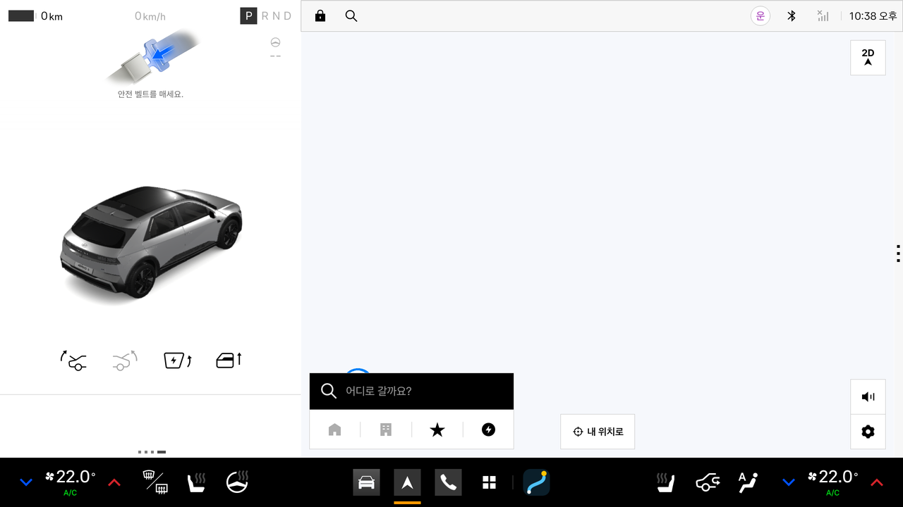
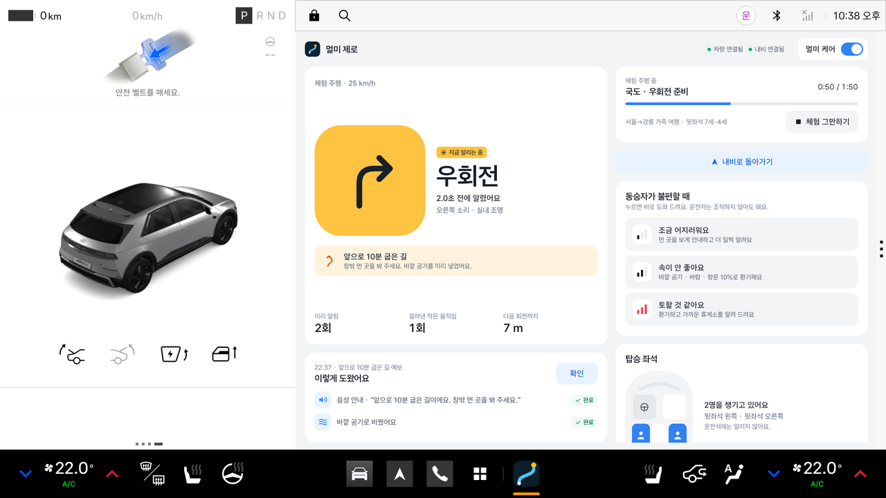
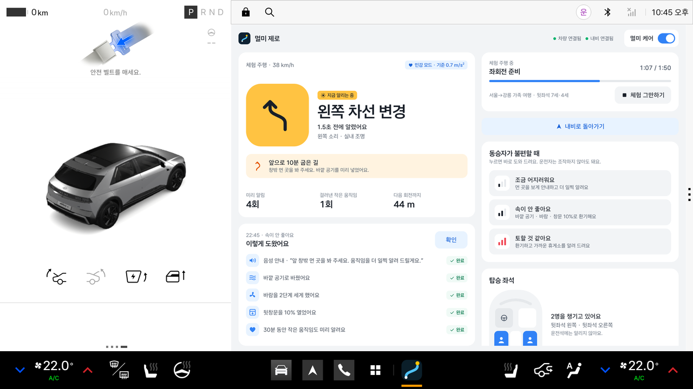
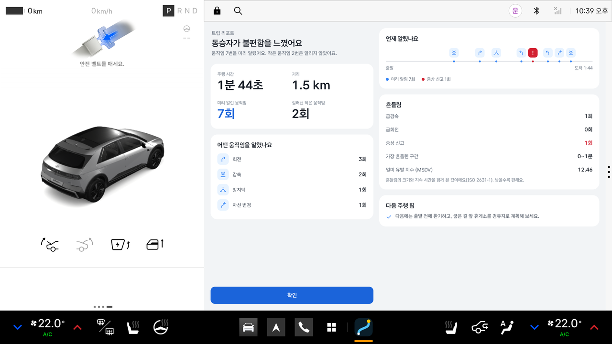
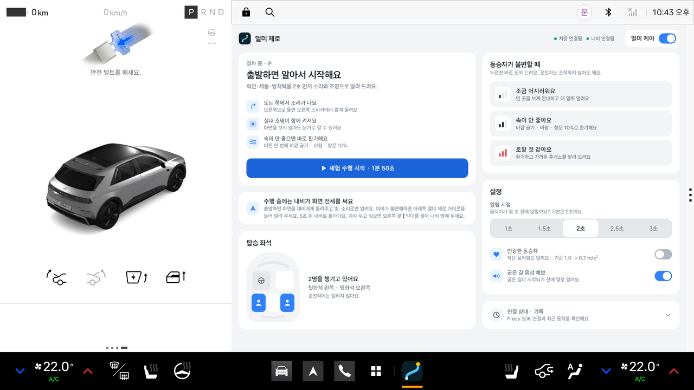
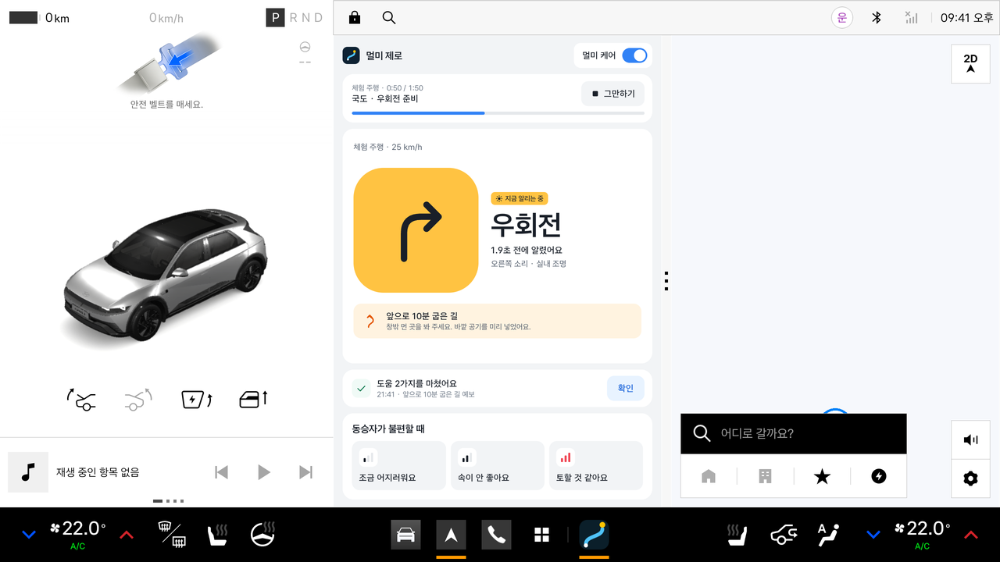

# 멀미 제로 (Motion Zero)

> 내비게이션과 차량 신호로 다음 회전·제동·과속방지턱을 1~3초 먼저 빛과 소리로 알려, 아이와 동승자의 멀미를 줄이는 Pleos Connect 동승자 케어 앱

현대자동차그룹 차량용 앱 개발 공모전 1차 제출용 MVP입니다.

- **APK:** [`apk/MotionZero_멀미제로_release.apk`](apk/MotionZero_멀미제로_release.apk) (release 빌드, 서명 포함)
- **데모 영상:** [`docs/demo/motionzero_demo.mp4`](docs/demo/motionzero_demo.mp4) (2분 7초, 에뮬레이터 실제 화면 + 효과음·음성 + 자막)
- **테스트 환경:** Pleos Connect Emulator **v2.1.0** (Android 14 / API 34, Automotive, arm64), 화면 **2560 × 1440, 160dpi (mdpi)**
- **실차 불필요:** 내장 **체험 주행(시뮬레이션)** 으로 전체 흐름을 재현할 수 있습니다.
- **에뮬레이터 실측:** 위 환경에서 Vehicle SDK·NaviHelper 연결, Virtual Console 신호 수신, 공조·창문·앰비언트 라이트 제어, Pleos TTS 음성 출력, 주행 규제(CarUxRestrictions), Pleos 창 정책(분할·확장), 화면 없이 백그라운드 동작, 체험 주행 전 과정을 직접 확인했습니다([실측 결과](#에뮬레이터-실측-결과)).

**주행 중에는 내비게이션이 화면 전체를 씁니다.** 멀미 제로는 화면을 차지하지 않고 뒤에서 빛과 소리로만 알리며, 정차 중과 도착했을 때만 화면에 나옵니다.

| 주행 중 · 내비가 화면 전체, 멀미 제로는 빛·소리로만 | 아래 아이콘을 누르면 지금 상황 · 우회전 2초 전 | 증상 신고 → 환기·바람·창문 자동, 5초 뒤 내비로 |
|---|---|---|
|  |  |  |

| 도착 · 음성 안내 후 트립 리포트 | 정차 중 홈(설정·체험 주행) | 선택: 내비 옆 창(1:1)에 두기 |
|---|---|---|
|  |  |  |

## 왜 차량에서만 가능한가

멀미의 핵심 원인은 "다음 움직임을 예측할 수 없다"는 점입니다. 운전자는 핸들을 돌리기 전에 알지만, 뒷좌석 승객은 모릅니다.
스마트폰은 이미 일어난 움직임만 알 수 있지만, 차량은 **다음 회전까지 남은 거리(NaviHelper)** 와 **운전자의 의도(방향지시등·브레이크·조향각, Vehicle SDK)** 를 알고 있습니다.
멀미 제로는 이 정보로 1~3초 뒤 움직임을 예측해, 화면을 보지 않는 승객에게도 **좌우로 구분되는 효과음과 앰비언트 라이트**로 미리 알려 줍니다.

## 구현 범위 (MVP)

| ID | 기능 | MVP 구현 | 사용 SDK |
|---|---|---|---|
| F1 | 움직임 예측 | 남은 시간 t = d ÷ v(기본 2.0초 전), 추측항법, 방향지시등·브레이크 엣지, 회생제동 감속 감지 | NaviHelper `onTBTInfo`·`onCautionPointInfo`·`onCurrentLocationInfo`, Vehicle SDK 조회 |
| F2 | 움직임 예고 | 좌/우 스테레오 효과음(회전 상승음·감속 하강음·방지턱 2연음), 앰비언트 라이트 1Hz 점멸 | Android AudioTrack + AudioFocus, Vehicle SDK `setAmbientLightSwitch` |
| F3 | 구간 예보 | "앞으로 10분 굽은 길이에요. 창밖 먼 곳을 봐 주세요." 음성 + 사전 환기. MVP에서는 체험 주행 시나리오가 예보 신호를 내며, 실제 경로의 굽은 구간 분석은 다음 단계 | TextToSpeech SDK (ON_DEVICE) |
| F4 | 증상 대응 | 1단계 기준 하향·시선 안내 → 2단계 외기 유입·풍량·창문 10% → 3단계 휴식 권장, 증상 신고 후 30분 민감 모드 (휴식 후 재출발 2시간 민감 모드는 엔진에만 구현, 휴게소 경유 연동은 다음 단계) | Vehicle SDK 제어(지원 확인 후), 미지원 시 음성 제안 |
| F5 | 좌석·민감도 | 좌석 점유로 동승자 인식(동승자가 없으면 예고·리포트 없음), 운전석에는 큐를 내지 않음, 민감 프로필 | Vehicle SDK `registerSeatOccupancy` |
| F6 | 트립 리포트 | 주행 시간·거리, 예고/억제 횟수, 급감속·급회전, 멀미 유발 지수(MSDV)와 상위 구간, 운전 코칭. 케어가 켜져 있었고 동승자가 있던 주행에만 표시. 1분 미만이면서 예고·증상 신고가 없던 이동(주차 중 기어 변경 등)과 중간에 멈춘 체험 주행은 생략 | – |
| F7 | 음성 신고 | **MVP 미포함(향후).** 공모 기간에는 Gleo Interface(App Schema) 신청이 불가해, SpeechToText(ON_DEVICE) "아이가 멀미해" 음성 신고를 다음 단계로 둡니다. MVP에서는 증상 버튼 3개로 신고합니다. | – |

큐를 낼지 정하는 규칙(오경보 최소화):

```
예상 |a| ≥ θ(보통 1.0 / 민감 0.7 m/s²)  AND  마지막 큐 이후 ≥ 4초  AND  내비 음성 안내 중 아님  AND  동승자 있음
```

"내비 음성 안내 중 아님" 조건은 엔진(`CueDecider`)에 구현되어 있지만, NaviHelper의 음성 안내 상태를 받아 오는 연결은 다음 단계입니다(현재는 항상 통과).

## 화면 구성: 주행 중에는 내비가 화면 전체 (Pleos 창 정책)

멀미 제로의 예고는 **빛과 소리**로 전달되므로, 주행 중에는 화면이 필요하지 않습니다. 실제 주행에서 내비게이션을 방해하지 않도록 **주행 중에는 앱 영역 전체를 내비게이션에 돌려주고, 멀미 제로는 화면 없이 동작**합니다.

| 시점 | 화면 | 구현 |
|---|---|---|
| 정차 중 | 앱 영역 전체: 소개, 체험 주행, 설정, 탑승 좌석 | `MainActivity` (방향 지정 없음) |
| 출발(기어 D·체험 주행) | **내비게이션이 앱 영역 전체로 앞에 옵니다**([화면](docs/screenshots/01_navi_full.png)). 멀미 제로는 뒤에서 회전·제동·방지턱을 효과음과 실내 조명으로, 굽은 길은 음성으로 알립니다 | 표준 지도 앱 인텐트 `CATEGORY_APP_MAPS`, 포그라운드 서비스 `MotionZeroService` |
| 주행 중 증상 신고 | 아래쪽 앱 바(GNB)의 **멀미 제로 아이콘**을 누르면 지금 상황과 증상 버튼 3개가 보입니다. 신고하면 환기·바람·창문을 바로 조절하고 **5초 뒤 내비로 돌아갑니다**. "내비로 돌아가기" 버튼도 있습니다 | 넓은 창 주행 배치 |
| 도착(기어 P) | **음성으로 "도착했어요…"** 라고 알리고, 아이콘을 누르면 **트립 리포트가 앱 영역 전체로** 열립니다. 주차 위치를 고치려고 R·D를 잠깐 넣어도 리포트는 남고, 본 리포트는 다시 출발하면 저절로 닫힙니다 | `TripReportActivity` (`screenOrientation="landscape"`) |
| 리포트 확인 | **내비게이션으로 복귀**([화면](docs/screenshots/06_back_to_navi.png)). 다음 주행도 뒤에서 계속 살핍니다 | `CATEGORY_APP_MAPS` |

**왜 이렇게 했나 (에뮬레이터에서 확인한 Pleos 제약):**

- **Connect-S의 창은 1:1 또는 한 앱 전체뿐입니다.** ⋮ 창 바를 끌어 보면 1:1(각 841px)과 한쪽 전체(1682px) 두 가지만 있고, 내비를 넓게 두고 앱을 얇게 두는 2:1 배치는 Connect-W(와이드 화면)에만 있습니다. 1:1에서는 내비가 화면의 절반만 쓰게 되므로, 앱을 아예 화면에서 빼는 쪽을 택했습니다.
- **일반 앱의 알림은 화면에 뜨지 않습니다.** Pleos 시스템 UI는 시스템·플랫폼 서명 앱의 알림만 띄웁니다(로그: `isSystemImportantNotification(privileged=false)`). 그래서 알림 버튼 대신 아이콘 → 증상 버튼 → 자동 복귀 흐름을 씁니다. 상태 알림의 증상 버튼은 일반 Android Automotive용 보조 수단으로 남겨 두었습니다.
- **Driving View의 미니 앱(위젯)은 시스템 앱 전용입니다.** 홈 화면이 정해 둔 위젯(미디어·빠른 제어·타이어 공기압·주행 정보)만 붙고 편집 화면이 없어, 서드파티 앱은 넣을 수 없었습니다.
- **앱이 내비 뒤에 있을 때 스스로 화면을 띄울 수 없습니다**(Android 백그라운드 실행 제한, 로그 `BAL_BLOCK`). 그래서 도착은 음성으로 알리고, 사용자가 아이콘을 누르면 리포트가 열립니다. 효과음·TTS·차량 제어는 화면이 없어도 동작합니다.
- 앱이 스스로 창을 **넓히는 것**(landscape 화면)은 되지만 **나누는 것**은 할 수 없습니다(`requestedOrientation` 변경, `FLAG_ACTIVITY_LAUNCH_ADJACENT`, `moveTaskToBack` 모두 홈 화면이 받아들이지 않음).

**선택: 내비 옆 창에 두기.** 지금 알림을 계속 화면에서 보고 싶다면 정차 중에 오른쪽 끝 **⋮ 창 바를 왼쪽으로 끌어** 내비와 1:1로 나눌 수 있습니다([화면](docs/screenshots/07_split_option.png)). 이때는 옆 창 전용 배치(지금 알림 · 구간 예보 · 증상 버튼)로 바뀌고, 출발해도 내비를 앞으로 부르지 않습니다.

## 디자인

- 화면을 처음 보는 사람도 1~2초 안에 읽을 수 있도록 **토스 디자인 시스템(TDS)의 구성 방식**을 따랐습니다: 회색 바탕 위 테두리 없는 흰 섹션, 큰 굵은 제목, 리스트 행·스위치·세그먼트·큰 버튼. 공개된 Android 라이브러리가 없어 Compose로 직접 구현했습니다(`ui/Tds.kt`, 외부 UI 라이브러리 없음).
- **Pleos UI 가이드 준수:** 시스템 글꼴(Asta Sans) 그대로 사용, 글자 대비 4.5:1 이상(주간·야간 전 조합 검사), 터치 영역 64dp 이상, 애니메이션·물결 효과 없음, 주간/야간 모드 자동 전환, 아이콘은 48dp 격자의 Canvas 선 아이콘(`ui/Glyphs.kt`).
- 강조색은 파랑 하나만 쓰고, 빨강(심한 증상)·초록(완료)·주황(예보·요청)·앰버(빛 큐)는 의미가 있을 때만 씁니다.

### 차속에 대해

Vehicle SDK 2.3.2에서 차속 리스너(`VehicleSpeedListener`)가 제거되었습니다. 공개 SDK 범위 안에서 동작하도록
**NaviHelper 현재 위치의 변화량(하버사인 거리 ÷ 시간)** 과 **다음 회전까지 남은 거리의 감소율**로 차속을 추정합니다(`core/SpeedEstimator.kt`).

## 아키텍처

```
Pleos SDK ─┬─ NaviHelper  (다음 회전·주의 구간·현재 위치)
           └─ Vehicle SDK (방향지시등·브레이크·조향각·기어·좌석 / 조명·공조·창문 제어)
                 │
                 ▼  core.Signal (SDK 무관한 신호 모델, 차속은 SpeedEstimator 로 추정)
   MotionZeroController ─▶ MotionCareEngine ─▶ MotionPredictor ─▶ CueDecider ─▶ AudioCue · LightCue
   (프로세스 단위, MotionZeroService 가          1~3초 뒤 예측       θ·4초·내비 음성·좌석
    화면 없이도 살려 둠)
                 │
   SymptomManager ─▶ ComfortController (지원 확인 후 실행, 미지원 시 음성 제안) ─▶ VoiceGuide(TTS)
   DiscomfortMeter ─▶ TripReport (MSDV, 급감속·급회전, 코칭)
   DemoReplaySource: 같은 Signal을 시간순으로 재생하는 시연용 주행
```

- `app/src/main/java/com/motionzero/app/core/` — Android 의존이 없는 핵심 로직 (단위 테스트 대상)
- `signal/` — Pleos Vehicle·NaviHelper 어댑터, 데모 재생
- `cue/` — 효과음·앰비언트 라이트·음성·공조/창문 출력
- `ui/` — Jetpack Compose 화면. `Tds.kt`(TDS 방식 공통 컴포넌트), `Theme.kt`(주간·야간 색·글자), `MainScreen.kt`(앱 영역 전체·내비 옆 창 배치), `TripReportScreen.kt`
- `MainActivity` — 홈·주행 화면(출발하면 내비로 넘기고, 증상 신고 5초 뒤 내비로 복귀), `TripReportActivity` — 도착 리포트(앱 영역 전체)
- `MotionZeroController` — 엔진·SDK 연결·출력을 프로세스 단위로 보유, `MotionZeroService` — 포그라운드 서비스(`specialUse`)로 화면 없이 동작, 도착 시 음성 안내
- `ReportRelay` — 도착 리포트를 화면으로 넘기는 통로, 내비게이션 호출(`openNavigation`)

## 실행 방법

### 1) 에뮬레이터 준비 (Pleos Connect Emulator v2.1.0)

1. Android Studio → Tools → SDK Manager → **SDK Update Sites** → `+`
   - macOS(Apple Silicon): `https://nexus-playground.pleos.ai/repository/raw-releases/connect-avd/2.x/crp-arm64-sys-img.xml`
   - Windows/Linux: `https://nexus-playground.pleos.ai/repository/raw-releases/connect-avd/2.x/crp-sys-img.xml`
2. SDK Platforms → Show Package Details → API 34 아래 **Pleos Connect v2.1.0** 시스템 이미지 설치
3. Device Manager → Automotive → **Pleos Connect v2.1.0** → Boot: **Cold boot**, RAM 4GB 이상

### 2) APK 설치·실행

```bash
adb install -r "apk/MotionZero_멀미제로_release.apk"
adb shell am start -n com.motionzero.app/.MainActivity
```

앱 목록에서 **멀미 제로**를 눌러 실행해도 됩니다. 차량·내비·TTS 권한은 매니페스트에 선언되어 있으며, 에뮬레이터에서는 별도 허용 화면 없이 연결되는 것을 확인했습니다.
앱 영역 전체로 열었을 때 위쪽 앱 바에 `차량 연결됨`, `내비 연결됨`이 초록 점과 함께 보이면 정상입니다. 아래쪽 **연결 상태 · 기록**을 펼치면 SDK 연결 상태와 최근 동작을 볼 수 있습니다.

**기본 사용(내비 전체 화면):** 내비게이션을 먼저 띄운 뒤 멀미 제로를 실행하고 **[체험 주행 시작]** 을 누르면, 몇 초 뒤 화면이 내비로 넘어가고 소리만 들립니다.
주행 중 아래쪽 앱 바의 멀미 제로 아이콘(2560 × 1440 기준 약 `1520, 1368`)을 누르면 지금 상황과 증상 버튼이 보입니다.

```bash
adb shell am start -n ai.umos.maps.android.navigation.app/.MainActivity
adb shell am start -n com.motionzero.app/.MainActivity
```

**선택(내비 옆 창):** 화면 오른쪽 끝의 **⋮ 창 바를 왼쪽으로 끌면** 내비와 1:1로 나뉩니다. 에뮬레이터에서는 `adb shell input swipe 2547 720 1694 720 800` 으로 재현할 수 있습니다.

### 3) 체험 주행 (시뮬레이션)

에뮬레이터 v2.1.0의 내비 서비스(NaviService 3.0.4)는 현재 위치가 한 지점에 고정되어 있고, Virtual Console에도 경로 주행 기능이 없어
실시간 회전 안내(TBT)·주의 구간 이벤트를 받을 수 없었습니다. 그래서 **[체험 주행 시작]** 을 누르면
"4인 가족(뒷좌석 7세·4세)의 서울→강릉 여행"을 약 110초로 압축한 신호가 재생됩니다. 아래 표와 [데모 영상](docs/demo/motionzero_demo.mp4)이 같은 흐름입니다.

| 시각 | 상황 | 앱 동작 |
|---|---|---|
| 0~2초 | 정차, 뒷좌석 2명 인식 | 좌석 표시, 기어 D. **몇 초 뒤 화면이 내비게이션으로 넘어감** |
| 18초 | 고속도로 차선 변경 | 예상 가속도 0.8 < θ 1.0 → **알리지 않음**(억제 기록) |
| 24초 | 굽은 구간 예보 | 음성 "앞으로 10분 굽은 길이에요…" + 외기 유입 |
| 35초 | 출구 감속(회생제동) | 감속 하강음 |
| (영상 44초) | – | 아이콘을 눌러 지금 상황 확인 → "내비로 돌아가기" |
| 약 49초 | 우회전 2초 전 | **오른쪽** 상승음 + 빛 큐 |
| 약 58초 | 과속방지턱 앞 | 2연음 |
| 약 71초 | 좌회전 2초 전 | **왼쪽** 상승음 + 빛 큐 |
| 77초 | "속이 이상해"(증상 보통, 시나리오가 자동 신고) | 시선 안내 음성, 외기 유입·풍량 +2·뒷창문 10%(미지원 시 음성 제안), 민감 모드. 화면은 내비 그대로 |
| 85·91초 | 완만한 좌회전, 차선 변경 | 민감 모드라 알림 |
| 97~106초 | 도착 감속 → 기어 P | 음성 "도착했어요. 멀미 제로를 열면 오늘 주행 리포트를 볼 수 있어요." |
| 아이콘 누름 | – | 트립 리포트를 앱 영역 전체로 표시 (예고 7회·억제 2회, MSDV, 코칭) |
| 리포트 확인 | – | 내비게이션이 다시 앞으로 |

체험 주행 중에는 실제 차량·내비 신호를 반영하지 않고, 끝나면 다시 실제 신호로 돌아갑니다.

### 4) Virtual Console로 차량 신호 확인 (선택)

```bash
adb forward tcp:8088 tcp:8088   # 브라우저에서 http://127.0.0.1:8088/ 을 열어 둔 채로 조작
```

| Virtual Console 조작 | 앱 반응 (실측) |
|---|---|
| Gear → D | 트립 기록 시작. 앱 영역 전체로 열려 있었다면 **내비게이션이 앞으로 옴**. 아이콘으로 다시 열면 상태 줄이 `주행 중 · D · 0 km/h`이고, 주행 규제(CarUxRestrictions)에 따라 설정을 숨기고 잠금 표시("주행 중에는 설정을 잠가 두었어요", 옆 창은 `설정 잠김` 배지). 화면은 유지(DO 선언) |
| Gear → P | 설정 잠금 해제. 동승자가 있고 D로 1분 이상 있었다면(또는 예고·증상 신고가 있었다면) 트립 리포트를 앱 영역 전체로 표시(앱이 내비 뒤에 있으면 음성 안내 후 아이콘을 누르면 표시). 짧은 이동은 `리포트 생략 (짧은 이동)` 기록 |
| Seat Occupancy | `탑승 좌석` 표시가 바뀜. 동승자가 없으면 예고하지 않음 |
| Turn Signal → Blink left/right | 차선 변경으로 판단. 보통 모드에서는 예상 가속도 0.8 < 1.0이라 `억제 · 왼쪽 차선 변경 — 기준 미만` 기록, 민감 모드에서는 예고 |
| Brake Pedal, Steering Angle | 수신됨. 단, 차속이 0이면 감속·횡가속도가 0이라 예고하지 않음 (아래 참고) |

Vehicle SDK 2.3.2에는 차속 API가 없고 에뮬레이터의 내비 위치는 고정이라, Virtual Console의 Speed 값은 앱에 들어오지 않습니다.
제동·조향에 따른 예고와 멀미 유발 지수는 **체험 주행**에서 확인할 수 있습니다.

## 빌드

```bash
# JDK 17, Android SDK (compileSdk 35)
./gradlew testDebugUnitTest      # 단위 테스트 41개 (예측·큐 판단·MSDV·차속 추정·체험 주행 시나리오·리포트 표시 조건·내비 매핑·효과음 합성)
./gradlew assembleRelease        # app/build/outputs/apk/release/
```

- Kotlin 2.0, Jetpack Compose, AGP 8.8, Gradle 8.11, minSdk 28 / targetSdk 35
- Pleos SDK: `ai.pleos.playground:Vehicle:2.3.2`, `NaviHelper:3.0.5`, `TextToSpeech:3.3.1`
  (저장소 `https://nexus-playground.pleos.ai/repository/maven-releases/`, 인증 불필요)
- 서명 키는 공모전 시연용으로 저장소에 포함했습니다(`keystore/`). 확인: `apksigner verify --print-certs apk/MotionZero_멀미제로_release.apk` (APK 서명 v2, `CN=MotionZero`)

## 주행 안전

- 동승자 케어는 주행 중에 동작해야 하므로 액티비티에 `distractionOptimized`(DO)를 선언했습니다. 선언하지 않으면 기어 D에서 시스템이 "주행 중에는 사용할 수 없습니다" 화면으로 앱을 가립니다(에뮬레이터 실측).
- **주행 중에는 내비게이션이 화면 전체를 씁니다.** 출발할 때 멀미 제로가 앱 영역을 덮고 있으면 스스로 내비를 앞으로 부르고, 주행 중 증상을 신고하려고 열었을 때도 5초 뒤 내비로 돌아갑니다. 개별 회전은 비언어 효과음과 빛으로만 알리고, 애니메이션이 없습니다.
- 증상 신고는 앞좌석 동승자가 아이콘 → 버튼 한 번으로 합니다(뒷좌석에만 동승자가 있을 때를 위해 음성 신고를 다음 단계로 둡니다). 음성은 굽은 길 예보·증상 대응·도착 안내에만 씁니다.
- 주행 규제(CarUxRestrictions)가 걸리면 설정·기록을 숨기고 잠금 표시를 합니다. 정차하면 다시 보입니다.
- 운전석에는 큐를 내지 않고, 동승자가 없으면 알리지도 리포트를 띄우지도 않습니다.
- 트립 리포트는 주행 중 사용 대상이 아니므로, 본 리포트는 다시 출발하면(기어 D·R 또는 주행 규제) 저절로 닫히고, 화면에 보이던 중이면 내비게이션이 앞으로 옵니다. 아직 보지 않은 리포트는 주차 위치를 고치는 짧은 R·D로는 지우지 않고, 새 주행이 1분을 넘기면 지웁니다. 주행 중에는 리포트를 열지 않습니다. 정차 직후 차속 추정이 늦게 0이 되는 것과 헷갈리지 않도록 P 단에서는 차속으로 트립을 시작하지 않습니다.
- 효과음은 오디오 포커스(`AUDIOFOCUS_GAIN_TRANSIENT_MAY_DUCK`)를 요청해 미디어를 잠깐 낮춘 뒤 돌려줍니다.

## 에뮬레이터 실측 결과

Pleos Connect Emulator v2.1.0 + Virtual Console에서 확인한 내용입니다.

| 항목 | 결과 |
|---|---|
| Vehicle SDK 조회 (방향지시등·브레이크·기어·조향·좌석) | 연결·수신 확인 |
| Vehicle SDK 제어 | 앰비언트 라이트(1개 영역), 외기 유입(내기 순환 해제), 풍량 3 → 5, 뒷창문 2곳 10% 실행 확인 |
| NaviHelper | 연결, 현재 위치 수신 확인. 위치 고정·경로 없음으로 TBT는 수신 불가 |
| TextToSpeech SDK (ON_DEVICE) | 한국어 음성 합성·재생 완료(`onDone`) 확인. 로캘은 `ko_KR`이어야 함(`ko`만 주면 `unsupported locale` 오류) |
| 주행 중 사용 | DO 선언 후 기어 D에서도 화면 유지, 주행 규제 시 설정 잠금 |
| Pleos 창 정책 | Connect-S는 1:1(각 841px) 또는 한 앱 전체(1682px)만 가능. 출발 시 `CATEGORY_APP_MAPS` 인텐트로 내비가 앱 영역 전체로 옴. ⋮ 창 바로 1:1 분할 시 옆 창 배치로 전환. landscape 리포트는 앱 영역 전체로 넓어짐 |
| 화면 없이 동작 | 내비가 앞에 있는 동안 효과음(오디오 포커스 허용)·TTS·외기/풍량/창문 제어 실행 확인. 포그라운드 서비스(`specialUse`) 유지 |
| 백그라운드 제약 | 내비 뒤에서 리포트 화면 실행은 시스템이 차단(`BAL_BLOCK`) → 음성 안내 후 아이콘으로 열기. 일반 앱 알림은 Pleos 화면에 표시되지 않음 |
| 주간·야간 모드 | `uimode night` 전환에 맞춰 색 전환 |

**좌석 점유 값 보정:** Vehicle SDK 2.3.2는 SEAT_OCCUPANCY 원시값이 `1`일 때 `isOccupied = true`를 돌려줍니다.
AOSP 규격(`VehicleSeatOccupancyState`)은 `1 = VACANT`, `2 = OCCUPIED`라서, Virtual Console에서 "탑승"으로 둔 좌석이 앱에는 빈자리로 들어왔습니다.
앱은 `PleosVehicleSource.SEAT_OCCUPANCY_INVERTED`로 이를 보정하며, SDK가 수정되면 이 값만 `false`로 바꾸면 됩니다.

## 한계와 다음 단계

- 효과 수치는 선행 연구의 결과이며, 멀미 제로 자체의 효과는 출시 후 측정합니다. 의학적 효능은 주장하지 않습니다.
- 차량 제어(조명·공조·창문)와 TTS는 Pleos 문서상 "준비 중"이라, 호출 전에 지원 여부를 확인하고 실패하면 음성 제안으로 바뀝니다.
- 주행 중 증상 신고는 아이콘을 눌러 앱을 여는 한 단계가 필요합니다. Pleos가 일반 앱의 알림·위젯을 화면에 띄우지 않기 때문이며, 다음 단계에서 STT 음성 신고("아이가 멀미해")와 Gleo 음성 호출(입점 시)로 화면 없이 신고하게 할 계획입니다.
- 도착 리포트는 음성 안내 후 사용자가 앱을 열 때 보입니다(백그라운드 화면 실행 제한).
- 다음 단계: 실차 신호로 예고 시점 보정(목표 오차 ±0.3초), NaviHelper 음성 안내 상태 연결, 실제 경로 기반 구간 예보, 휴게소 경유(`requestRouteWithWaypoints`), STT 음성 신고, 멀미 지도, Gleo 음성 호출(입점 시), Connect-W 2:1 배치에서 얇은 옆 창 지원.
